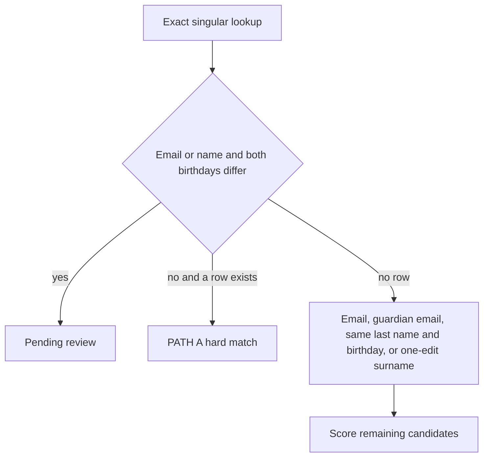

# Matching policy

Baseline as of 2026-11-15, after the email and name birthday reviews. Decision 5B, on 2026-11-20, added the one-edit surname search below. Decision 3 and Decision 6 are approved exact-name rules and are not yet what the resolver does. Except for that section, this document describes the resolver in `src/modules/resolverEngine.js` and `src/modules/probabilisticMatcher.js`. It is the reference for later matching changes.

Nothing here is a proposal. The system does not merge two people on its own. A review waits for a person. The merge happens only when someone confirms it.

A missing birthday is not a conflict. A birthday conflict exists only when both records have a birthday and those birthdays differ.

## How a resolution runs

A call has one singular identifier, plus any extra fields sent with it.

The first step is an exact lookup for a live person who already holds that same identifier. A hit is a hard match: the existing person is returned, and their identifier is marked as seen again. Email and name are the exceptions below. Every other identifier type returns on that hit before the birthday is read.

If the lookup misses, the resolver searches people who share an exact email, an exact guardian email, the same last name and the same birthday, or the same first name, the same birthday, and a surname within one edit. Those people are scored. An approved rule, not yet in the resolver, also retrieves a listed nickname with that exact surname even when the birthdays differ. That retrieval is not a hard match. A birthday conflict on a scored person rejects that person before any other agreement is counted. An email disagreement, a name disagreement, or a ZIP disagreement lowers the score. It does not reject the person by itself. Finding a person with the one-edit surname search does not make them the same person.

The diagram is the resolver as it runs. An exact name with either birthday missing still takes the hard-match branch. An exact name with both birthdays equal and no incoming email does too. The combined rule below sends both of those shapes to review once it is implemented. An exact name with both birthdays equal and an incoming email present stays a hard match. Present means the incoming email is non-missing. It does not have to equal the stored email.

## One-edit surname

Decision 5B. This is a search rule. It does not decide that two records are the same person.

The search runs only after the exact identifier lookup misses. It returns a live person when all three are true:

- The first word of the normalized name is the same.
- The birthday is present on both records and is the same.
- The raw Levenshtein distance between the normalized surnames is 0 or 1.

The surname is the last word. The distance is the Levenshtein function the scorer already uses. A distance of 0 is the exact surname. That person is also returned by the last-name-and-birthday search, and the two results are one candidate.

A person found this way is scored with the existing rules. The result can be a review or a new person. It is not a hard match from this search. An exact email, or an exact full name, is still decided before this search runs.

The bound of 1 comes from the four CO-2 surname typos: Bramley/Bramly, Ostler/Ostlar, Quinlan/Quinlen, and Sutcliffe/Sutclife. Each is one edit. A replaced surname is several edits and is not returned by this key. An exact email can still find a person whose surname was replaced.

The same first name and birthday can belong to many people. The distance is applied before the cap of 50. Only people who already pass the three conditions count toward that cap. If more than 50 do, that whole group is dropped and none of them are scored. People who share the first name and birthday but fail the surname distance are not part of that count, and they do not cause the group to be dropped.

Tests live in `tests/modules/decision5b.surnameRetrieval.test.js`.

What this search does not do:

- It does not match a different first name. The last-name-and-birthday search still can, when the surname and birthday are exact.
- It does not match a different birthday, or a missing birthday.
- It does not match a one-word name. There is no separate surname.
- It does not match a transposition. Smith and Smtih are two edits.
- It does not match a replaced surname.
- It does not change scores, thresholds, nickname groups, or the hard-match rules.
- A short full name can be found and still stored as a new person. Bo Xu and Bo Yu are one surname edit, and the existing full-name comparison does not call that spelling close enough to open a review.

## What each identifier does

**Email.** Evidence of a person, and one email belongs to one person in an organization (household rows are the exception). A review opens only when every stored birthday differs from the inbound birthday. The original person keeps the email. The incoming record does not receive a second copy. One stored birthday that matches keeps the hard match, even if another stored birthday on that person differs. A missing birthday on either side keeps the hard match. A different email lowers a score only after some other key already found the person.

Example: `ada@example.com`, born 1990-04-02, then the same email born 1991-04-02. Review. Ada keeps the email.

**Name.** Evidence, and many people may share it. In the resolver today, a review opens only when every stored birthday differs from the inbound birthday. Both people keep the name. One stored birthday that matches keeps the hard match, even if another stored birthday on that person differs. A missing birthday on either side keeps the hard match. An exact name with both birthdays equal also keeps the hard match when the incoming row has no email. Those two hard matches are current resolver behavior. The combined rule below replaces both, and the code does not do that yet. The lookup uses the exact normalized name. In the resolver today, a nickname or a close spelling is scored only when a search key already found that person. The one-edit surname search above is one of those keys. It does not change how the name is scored. The nickname retrieval rule below is approved and is not one of those keys yet.

Example: Jane Doe, born 1990-04-02, then Jane Doe, born 1991-05-06, and neither row has an email. Review. Both records keep the name Jane Doe. The search by last name plus birthday does not find her, because the birthdays differ. The review still names her, because the exact-name lookup did.

When several people share that exact name, the lookup reads one of them, with no set order. The birthday check applies to that person. The others are not part of that decision.

**Phone.** A CSV import stores a phone after the match is chosen. The matcher does not read it, so a phone on a file cannot find a person and cannot be compared with a birthday. A direct resolve call can send the phone as the singular identifier. That call hard-matches the existing person and does not read the birthday. A second person cannot store the same phone. The first person is already saved, so the second write fails. That failure is not a review.

**Guardian email.** A household key. Children are expected to share it and to have different birthdays. An import does not use it as the singular identifier. When it arrives beside a card id, the children are retrieved, a different birthday rejects that child, and the result is a separate person with no review. A direct resolve call that sends the guardian email as the singular identifier hard-matches one child and does not read birthdays. If more than one child shares it, which child is returned is not ordered. A guardian email shared by more than 50 live people is dropped, and nobody in that group is scored.

**Guardian phone.** Stored for a household. It is not a search key and it is not a score. As the singular identifier on a direct resolve call, it is a hard match.

**Card and account ids.** An NFC id, an NBA id, or a Ticketmaster id is treated as that account. An exact id is a hard match, including when the same call carries a different birthday. After a merge, a tap of the old card resolves to the surviving person.

**Birthday and ZIP.** Many people may share either value. As the singular identifier on a direct resolve call, an arbitrary live person with that value is a hard match. The lookup has no set order. The other fields on the call are not read. The same unordered choice applies when several people share an exact name. An import does not send birthday or ZIP as the singular identifier. ZIP can lower or raise a score only after some other key already found the person. A ZIP disagreement subtracts a small penalty.

**Device id.** Evidence that a device was present. It is not stored as an identifier, and it cannot start a match. It can add to a score only after some other key already found the person.

## Several people on one call

After the exact lookup misses, the search can return more than one person. The highest score is the one considered. An equal score keeps the person returned first. A birthday conflict scores zero and loses to any higher score. A name and the same birthday can still open a review when the score is low, unless another person already scores high enough for review.

An email birthday review, or a name birthday review, replaces that winner. The person from the exact lookup is the one reviewed, even when someone else on the same call scored higher.

Inside one scored pair, a birthday conflict is decided before email, name, ZIP, guardian email, or device evidence. Those agreements cannot override it. A disagreement is counted only when both records have that field. Phone, guardian phone, and device id are not disagreement fields.

## Exact name — Decision 3 and Decision 6

Approved, and not implemented. Decision 3 is the more specific exception. Decision 6 governs an exact name when either birthday is missing. The name section above is what the resolver does today. It hard-matches all four shapes below except the birthday conflict, which is already a review.

An exact-name candidate stays eligible in every shape. A missing birthday is not a birthday conflict. A conflict exists only when both birthdays are present and they differ.

When an exact-name candidate is found:

1. Both birthdays present and equal, and an incoming email is present: the existing exact-name hard match stays. Present means the incoming email is non-missing. The value does not have to equal the email on the stored person.
2. Both birthdays present and equal, and the incoming email is missing: open a human review. This is Decision 3.
3. Both birthdays present and different: open a human review under the existing birthday-conflict policy.
4. Either birthday missing: open a human review, whichever record is missing the birthday. This is Decision 6. Do not link the records automatically.

Required future behavior. Keep the exact-name lookup. For shapes 2 and 4, create a pending review instead of returning that person as a hard match. Do not drop the candidate. Do not change the score thresholds to produce the review. Do not change an exact-email hard match. A missing birthday still keeps that email hard match, including MB-1, where the email and the name both match and the probe birthday is missing.

MB-3 and MB-4 are shape 4. They are one observationally indistinguishable class. In both, the stored person has an email and no birthday, and the incoming row has the same name, no email, and a birthday. The synthetic labels say MB-3 is a different person and MB-4 is the same person. Those labels stay. The fields cannot tell the two groups apart, and this policy does not claim the matcher can. Both groups get a human review under Decision 6. The measured import hard-matched both. That measurement is the historical result. It is not this policy.

CA-4 and A-NO-EMAIL are shape 2. Both birthdays match and the incoming email is missing. Both get a human review under Decision 3. The 15 Set A A-NO-EMAIL probes, rows 126–140, keep that same treatment. They are not a separate rule. The measured import hard-matched both groups. CA-4 is labeled a different person. A-NO-EMAIL is labeled the same person. Those labels stay. The columns of one row do not say which label it is.

## Nickname retrieval

Approved, and not implemented. A recognized nickname pair with the same surname may retrieve a candidate even when the birthdays differ. The recognized pairs are the existing nickname groups in `GIVEN_NAME_GROUPS`. This is retrieval permission only. It does not hard-match and it does not merge. The birthday disagreement stays a conflict for the identity evaluation. It is not treated as agreement. Decision 5A is unchanged: that rule still requires an exact first name and an exact surname. A nickname is not an exact first name.

The resolver does not retrieve on a nickname today. CO-1 was missed for that reason. The birthday swap on those four rows stays a conflict once a candidate is retrieved.

## First-name conflict

Approved, and not implemented. This defines the conflicting first name in Decision 1.

Two populated first names are equivalent only when they match exactly, or when the pair is on an explicit list of approved variants. That list includes the approved nicknames. Fuzzy similarity alone does not establish equivalence. The resolver today still treats a full-name similarity of 0.85 as a name match. That scoring behavior is not this rule.

When both first names are populated, they are not an exact match, and the pair is absent from the approved list, the difference is an identity conflict. Send the candidate for human review. Do not automatically link or merge the records.

SFE-2 and SFE-3 are that conflict. The first names are populated, they differ, and they are not a listed nickname pair. Both the missing-birthday email hit and the agreeing-birthday email hit go to review. The resolver today hard-matches both on the email.

No separate spelling-variant inventory was approved beyond those nickname groups. This policy does not add names to the list. A first name missing on one side is not decided here.

## Still a hard match

These lookups still return the existing person before a contradictory birthday is read:

- Phone, guardian email, guardian phone, NFC id, NBA id, Ticketmaster id, birthday, or ZIP, when that value is the singular identifier.
- The same email when either birthday is missing.
- The same exact name when either birthday is missing. This is current resolver behavior. Decision 6 replaces it with a review once implemented.
- The same email, or the same exact name, when one stored birthday matches the inbound birthday, even if another stored birthday differs.
- The same exact name and the same birthday when an incoming email is present. Present means non-missing. The incoming email does not have to equal the stored email.
- The same exact name and the same birthday when the incoming email is missing. This is current resolver behavior. Decision 3 replaces it with a review once implemented. CA-4 and A-NO-EMAIL are that shape.

A shared guardian email with different birthdays stays two people, and does not open a review, when the guardian email is not the singular identifier.

One email, and one phone, still belong to one person in an organization, outside household rows.
