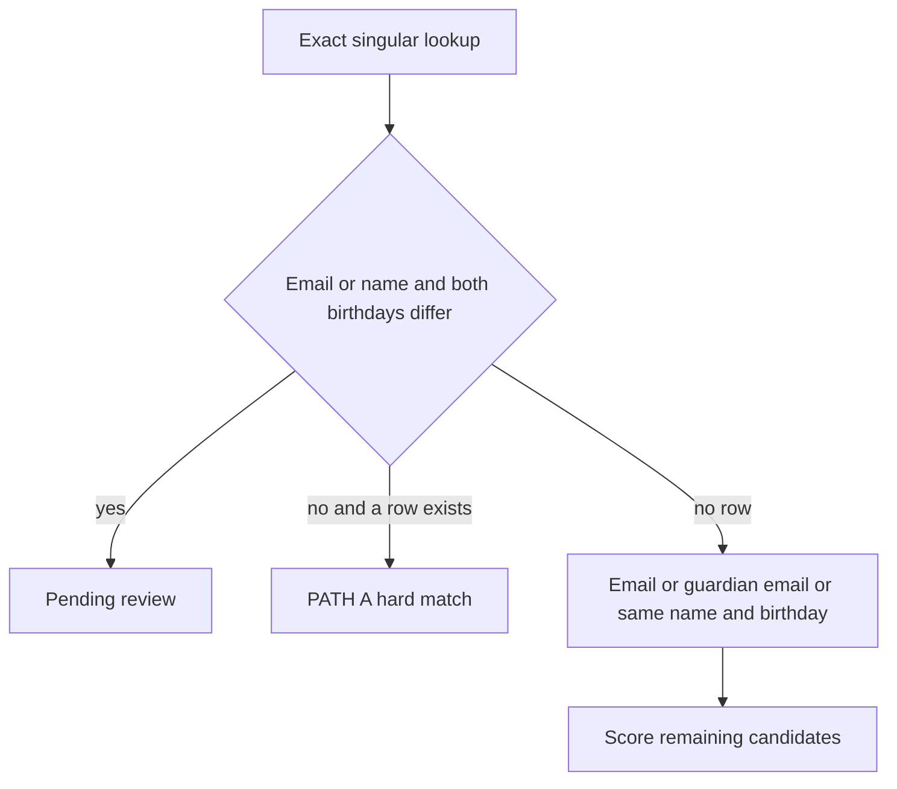

# Matching policy

Baseline as of 2026-11-15, after the email and name birthday reviews. This describes the resolver in `src/modules/resolverEngine.js` and `src/modules/probabilisticMatcher.js`. It is the reference for later matching changes.

Nothing here is a proposal. The system does not merge two people on its own. A review waits for a person. The merge happens only when someone confirms it.

A missing birthday is not a conflict. A birthday conflict exists only when both records have a birthday and those birthdays differ.

## How a resolution runs

A call has one singular identifier, plus any extra fields sent with it.

The first step is an exact lookup for a live person who already holds that same identifier. A hit is a hard match: the existing person is returned, and their identifier is marked as seen again. Email and name are the exceptions below. Every other identifier type returns on that hit before the birthday is read.

If the lookup misses, the system searches only people who share an exact email, an exact guardian email, or the same last name and the same birthday. Those people are scored. A birthday conflict on a scored person rejects that person before any other agreement is counted. An email disagreement, a name disagreement, or a ZIP disagreement lowers the score. It does not reject the person by itself.

## What each identifier does

**Email.** Evidence of a person, and one email belongs to one person in an organization (household rows are the exception). A review opens only when every stored birthday differs from the inbound birthday. The original person keeps the email. The incoming record does not receive a second copy. One stored birthday that matches keeps the hard match, even if another stored birthday on that person differs. A missing birthday on either side keeps the hard match. A different email lowers a score only after some other key already found the person.

Example: `ada@example.com`, born 1990-04-02, then the same email born 1991-04-02. Review. Ada keeps the email.

**Name.** Evidence, and many people may share it. A review opens only when every stored birthday differs from the inbound birthday. Both people keep the name. One stored birthday that matches keeps the hard match, even if another stored birthday on that person differs. A missing birthday on either side keeps the hard match. The lookup uses the exact normalized name. A nickname or a close spelling is scored only when a search key already found that person.

Example: Jane Doe, born 1990-04-02, then Jane Doe, born 1991-05-06, and neither row has an email. Review. Both records keep the name Jane Doe. The search by last name plus birthday does not find her, because the birthdays differ. The review still names her, because the exact-name lookup did.

When several people share that exact name, the lookup reads one of them, with no set order. The birthday check applies to that person. The others are not part of that decision.

**Phone.** A CSV import stores a phone after the match is chosen. The matcher does not read it, so a phone on a file cannot find a person and cannot be compared with a birthday. A direct resolve call can send the phone as the singular identifier. That call hard-matches the existing person and does not read the birthday. A second person cannot store the same phone. The first person is already saved, so the second write fails. That failure is not a review.

**Guardian email.** A household key. Children are expected to share it and to have different birthdays. An import does not use it as the singular identifier. When it arrives beside a card id, the children are retrieved, a different birthday rejects that child, and the result is a separate person with no review. A direct resolve call that sends the guardian email as the singular identifier hard-matches one child and does not read birthdays. If more than one child shares it, which child is returned is not ordered. A guardian email shared by more than 50 live people is dropped, and nobody in that group is scored.

**Guardian phone.** Stored for a household. It is not a search key and it is not a score. As the singular identifier on a direct resolve call, it is a hard match.

**Card and account ids.** An NFC id, an NBA id, or a Ticketmaster id is treated as that account. An exact id is a hard match, including when the same call carries a different birthday. After a merge, a tap of the old card resolves to the surviving person.

**Birthday and ZIP.** Many people may share either value. As the singular identifier on a direct resolve call, an arbitrary live person with that value is a hard match. The lookup has no set order. The other fields on the call are not read. The same unordered choice applies when several people share an exact name. An import does not send birthday or ZIP as the singular identifier. ZIP can lower or raise a score only after some other key already found the person. A ZIP disagreement subtracts a small penalty.

**Device id.** Evidence that a device was present. It is not stored as an identifier, and it cannot start a match. It can add to a score only after some other key already found the person.

## Several people on one call

After the exact lookup misses, the search can return more than one person. The highest score is the one considered. An equal score keeps the person returned first. A birthday conflict scores zero and loses to any higher score. A name and the same birthday can still open a review when the score is low, unless another person already scores high enough for review.

An email birthday review, or a name birthday review, replaces that winner. The person from the exact lookup is the one reviewed, even when someone else on the same call scored higher.

Inside one scored pair, a birthday conflict is decided before email, name, ZIP, guardian email, or device evidence. Those agreements cannot override it. A disagreement is counted only when both records have that field. Phone, guardian phone, and device id are not disagreement fields.

## Still a hard match

These lookups still return the existing person before a contradictory birthday is read:

- Phone, guardian email, guardian phone, NFC id, NBA id, Ticketmaster id, birthday, or ZIP, when that value is the singular identifier.
- The same email, or the same exact name, when either birthday is missing.
- The same email, or the same exact name, when one stored birthday matches the inbound birthday, even if another stored birthday differs.
- The same exact name and the same birthday.

A shared guardian email with different birthdays stays two people, and does not open a review, when the guardian email is not the singular identifier.

One email, and one phone, still belong to one person in an organization, outside household rows.
